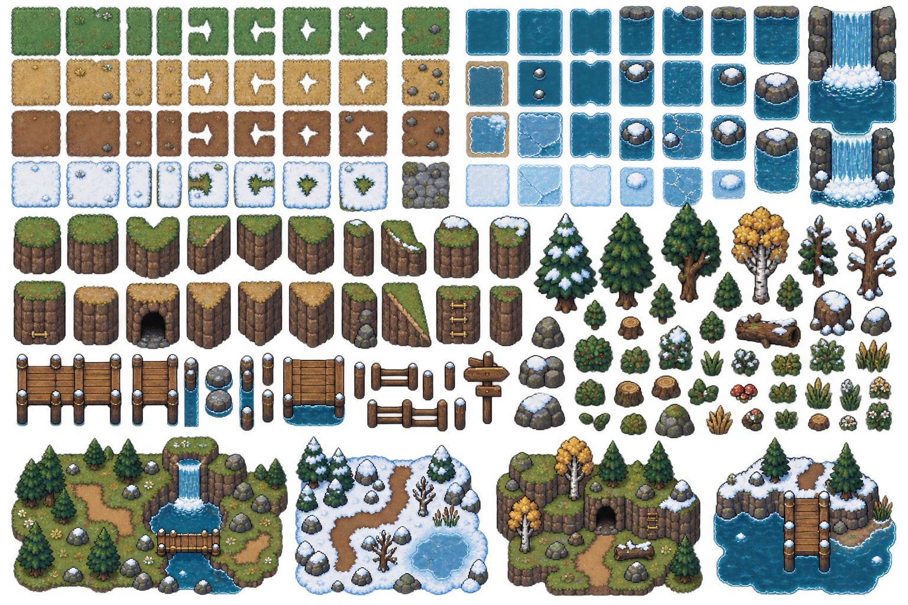

# Rorymon

Rorymon is an original monster-catching RPG prototype set in a sub-polar taiga inspired by Alaska and northern Canada. The repository combines a playable browser-based battle system, an explorable overworld, a species editor, an evolving content dataset, and the original visual and audio assets used by the demos.



## What is playable

- A turn-based trainer battle with parties, switching, experience, status effects, move PP, evolution-line move sets, and persistent browser-session progress.
- Wild encounters and capture mechanics with multiple Roryball grades.
- A level-30 exhibition mode featuring all 24 valid three-animal Totammpöl assemblies.
- A tile-based overworld with camera tracking, collision, terrain, running, saved position, tall-grass encounters, and battle transitions.
- A browser editor for experimenting with Rorymon definitions and move data.
- PostgreSQL migrations for persistent saves, teams, encounters, battles, storage, and world state.

## Run locally

Rorymon has no package-install step. It needs a recent version of Node.js.

```powershell
cd demo\battle
node server.mjs
```

Then open:

- Battle: <http://127.0.0.1:4173/>
- Overworld: <http://127.0.0.1:4173/demo/overworld/>
- Level-30 exhibition: <http://127.0.0.1:4173/demo/battle/?battle=1&level=30>

## Test

```powershell
cd demo\battle
node --test combat-engine.test.mjs
```

## Project map

- `content.json` — core types, moves, species, evolutions, and asset references.
- `demo/battle` — battle engine, browser interface, local server, and automated tests.
- `demo/overworld` — map, movement, collision, encounters, and transitions.
- `demo/editor` — in-browser content editing prototype.
- `assets` — original concepts, sprites, animation previews, effects, UI, environments, items, and audio.
- `postgresql` — schema migrations, verification queries, seed data, and local setup notes.
- `tools` — asset-cleaning and sprite-generation utilities.

## Status

This is a work in progress. Some numeric balance values, procedural map elements, placeholder sound assignments, and editor workflows are still provisional; the detailed README files inside each demo and the PostgreSQL folder describe the current behavior and known boundaries.

The repository intentionally excludes local credentials. Copy `postgresql/.env.example` to a local `.env` only when configuring a database, and never commit the populated file.
